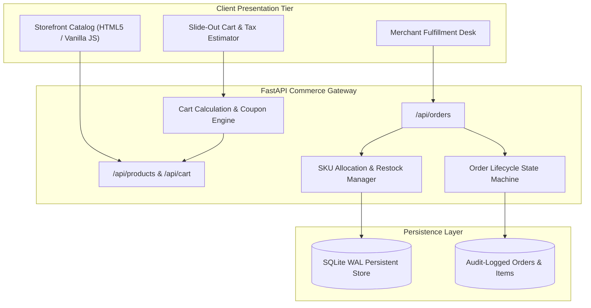

# CommerceHub

[](https://github.com/Soulofghost/commercehub/actions/workflows/ci.yml)
[](LICENSE)
[](https://www.python.org/downloads/)
[](https://fastapi.tiangolo.com)
[]()

> **CommerceHub** is an enterprise e-commerce storefront and merchant order operations platform. It features real-time SKU variant inventory management, deterministic cart calculation engines (tiered shipping rules, coupon vouchers, and state sales taxes), and strict order checkout state machines.

---

## 🏛️ System Architecture



---

## ⚡ Core Engineering Capabilities

1. **Deterministic Cart Calculation Engine (`checkout_inventory.py`)**
   - Item subtotal formula:
     $$\text{Subtotal} = \sum_{i} (\text{Unit Price}_i \times \text{Quantity}_i)$$
   - Discount deduction support:
     - `PERCENT` (e.g. `WELCOME10` $\to$ 10% off subtotal).
     - `FIXED` (e.g. `VIP50` $\to$ $50 flat discount).
     - `FREE_SHIPPING` (e.g. `FREESHIP` $\to$ eliminates freight fee).
   - Tiered Freight logic:
     - Free standard shipping automatically applied when $\text{Subtotal} \ge \$100.00$.
     - Standard Ground: $15.00 ($0.00 if $\ge \$100.00$).
     - Express Air: $25.00 ($10.00 if $\ge \$100.00$).
   - Sales tax evaluation applied against net taxable base ($\text{Subtotal} - \text{Discount}$) at 8.25%.

2. **Atomic SKU Inventory Allocation & Restock Protection**
   - Verifies stock quantity for each SKU variant before order commitment.
   - Rejects checkout attempts with $400\ \text{Bad Request}$ if requested quantity exceeds available physical stock.
   - Automatically and atomically decrements SKU inventory upon order creation.
   - If an order is marked `CANCELLED`, all purchased quantities are restocked into available inventory.

3. **Order Lifecycle State Machine**
   - Enforces linear fulfillment transitions:
     $$\text{PAID} \longrightarrow \text{PROCESSING} \longrightarrow \text{SHIPPED} \longrightarrow \text{DELIVERED}$$
   - Any order before `SHIPPED` can transition to `CANCELLED` (triggering automatic restocking).
   - Delivered and Cancelled orders are terminal.

---

## 🔌 API Reference

| Method | Endpoint | Description |
|---|---|---|
| `GET` | `/api/health` | Healthcheck and commerce service version |
| `GET` | `/api/products` | Catalog listing with SKU variants and real-time stock |
| `GET` | `/api/products/{id}` | Single product detail with variant options |
| `POST` | `/api/cart/calculate` | Compute subtotal, coupon discounts, shipping, and tax |
| `POST` | `/api/orders/checkout` | Commit order, decrement SKU stock, set status to PAID |
| `GET` | `/api/orders` | Merchant order pipeline (filterable by status) |
| `GET` | `/api/orders/{id}` | Detailed order invoice with line items |
| `PATCH` | `/api/orders/{id}/status` | Execute lifecycle transition (`PROCESSING`, `SHIPPED`, `CANCELLED`) |
| `GET` | `/api/analytics/store-metrics` | Telemetry on gross revenue, orders count, and low-stock SKUs |

---

## 🚀 Getting Started

### Local Development

1. **Clone repository:**
   ```bash
   git clone https://github.com/Soulofghost/commercehub.git
   cd commercehub
   ```

2. **Install dependencies:**
   ```bash
   pip install -r backend/requirements.txt
   ```

3. **Run tests:**
   ```bash
   pytest backend/tests -v
   ```

4. **Start the application:**
   ```bash
   uvicorn backend.app.main:app --reload --port 8000
   ```
   Open `http://localhost:8000` to access the Storefront and Merchant Desk.

---

### Docker Deployment

```bash
docker-compose up --build -d
```

---

## 👨‍💻 Author

**Alvin MS**  
GitHub: [@Soulofghost](https://github.com/Soulofghost)
